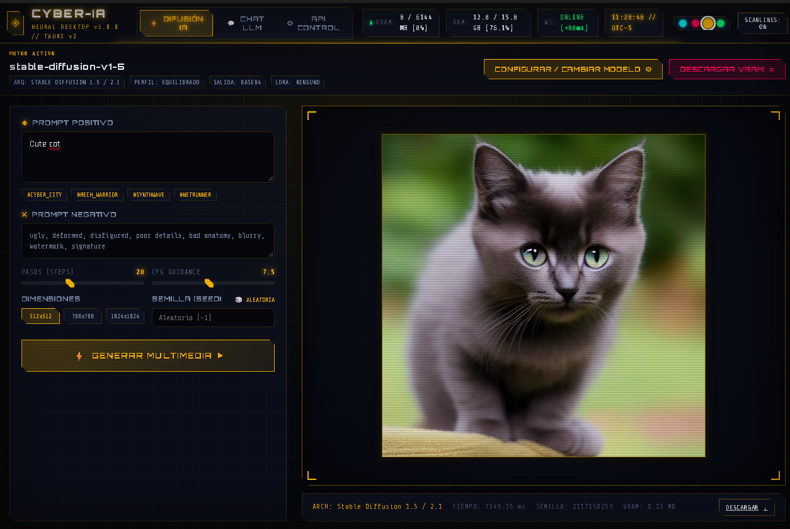
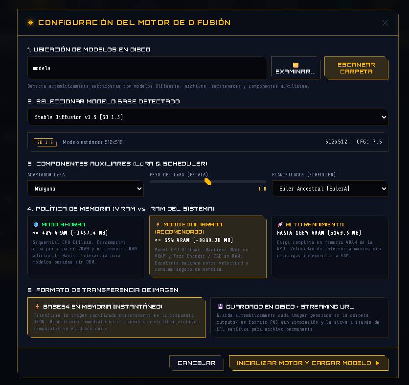
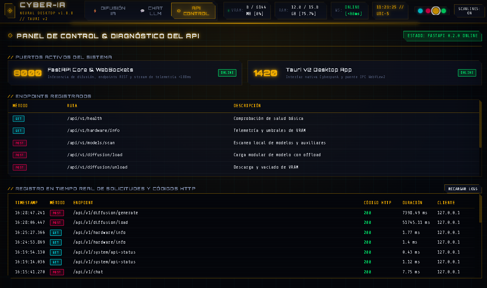

# ⚡ CYBER-IA // IA Interface for Desktop

<div align="center">

[](README.md)
[](README_EN.md)


**Plataforma de escritorio de alto rendimiento para ejecución, gestión e inferencia de modelos de IA locales (Difusión Multimedia y LLMs) con estética Cyberpunk HUD y telemetría en tiempo real.**

[Características](#-características-principales) • [Capturas en Vivo](#-demostración-visual-en-ejecución) • [Arquitecturas Soportadas](#-arquitecturas-de-ia-soportadas) • [Requisitos](#-requisitos-del-sistema) • [Instalación](#-instalación-y-despliegue) • [Contribución](CONTRIBUTING.md) • [Código de Conducta](CODE_OF_CONDUCT.md) • [Notas de Versión](RELEASE_NOTES.md) • [Licencia](#-licencia-y-propiedad-intelectual)

</div>

---

## 🌟 Descripción General

**IA Interface for Desktop (CYBER-IA)** es una aplicación de escritorio diseñada para eliminar la complejidad de ejecutar modelos de Inteligencia Artificial generativa de forma 100% local, privada y optimizada. Combina la velocidad nativa de **Tauri v2 (Rust)** en el frontend con la flexibilidad de un motor modular en **FastAPI (PyTorch / Diffusers)** en el backend.

El sistema incorpora un **controlador dinámico de memoria de hardware**, permitiendo ejecutar modelos de última generación (desde Stable Diffusion 1.5 hasta Diffusion Transformers de 2B parámetros) incluso en tarjetas gráficas de gama media con 6 GB de VRAM (como la NVIDIA RTX 3050), protegiendo la estabilidad del sistema mediante alertas proactivas y telemetría por WebSocket con latencias inferiores a **80 ms**.

---

## 📸 Demostración Visual en Ejecución

A continuación se muestran capturas reales de la aplicación durante su ejecución en entorno de escritorio:

### 1. Estudio Multimedia de Difusión (HUD Cyberpunk)

*Vista principal del estudio de generación local con el lienzo interactivo de renderizado neón, previsualizaciones en vivo, selectores de schedulers, telemetría por WebSocket y controles avanzados de hardware.*

### 2. Explorador y Configuración Modular de Modelos

*Modal interactivo de escaneo local con integración directa al Explorador de Archivos de Windows, reconocimiento de arquitecturas (Anima DiT, SDXL, SD 1.5), inyección de adaptadores LoRA y asignación de perfiles adaptativos de VRAM.*

### 3. Consola de Control de Red y Diagnóstico de API

*Panel de telemetría de red en vivo monitoreando el estado de los puertos (FastAPI 8000 / Tauri 1420), catálogo interactivo de endpoints OpenAPI/Swagger y registro de latencia de peticiones HTTP en tiempo real.*

---

## 🚀 Características Principales

### 🎨 1. Interfaz HUD Cyberpunk (Tauri v2 + Rust)

- **Diseño Neón Modular**: Arquitectura CSS y JavaScript ES Modules ultraligera, libre de frameworks pesados, con acentos cian, magenta y ámbar configurables.
- **Lienzo Multimedia Interactivo**: Canvas con marco de neón, previsualizaciones en tiempo real, efectos de scanlines conmutables y descarga directa en alta resolución.
- **Barra de Progreso WebSocket**: Visualización fluida del progreso de cada paso de difusión paso a paso con menos de 80ms de retraso.
- **Explorador Nativo de Windows**: Botón integrado para examinar directorios locales directamente con el Explorador de Archivos de Windows.

### 🧠 2. Motor de Difusión Multi-Arquitectura

- **Patrón Adapter Extensible**: Desacoplamiento total entre el motor y los formatos de peso, seleccionando dinámicamente el adaptador óptimo según la cabecera del modelo.
- **Soporte de Modelos Multicomponente**: Detección y ensamblado quirúrgico de modelos que distribuyen sus pesos en archivos independientes (`.safetensors` transformer DiT, `_txt.safetensors` Qwen text encoder, `_vae.safetensors` Wan/Qwen VAE).
- **Inyección de Componentes Auxiliares**: Soporte nativo para adaptadores **LoRA** (con ajuste de peso de 0.0 a 2.0) y conmutación de planificadores de ruido (**EulerA, DPM++ 2M Karras, DDIM, UniPC**).
- **Salida Configurable**: Elección entre renderizado en memoria **Base64** (ultra-rápido en memoria) o persistencia en disco en carpeta `outputs/` con URLs locales.

### 🛡️ 3. Motor Adaptativo de Hardware y Protección de VRAM

- **Detección Automática de Hardware**: Identificación precisa de GPU vía NVML/CUDA calculando umbrales dinámicos en tiempo real según la VRAM total disponible:
  - **Modo Ahorro (≤ 40% VRAM)**: Aplica descargas secuenciales y protección de memoria para equipos con recursos compartidos.
  - **Modo Equilibrado (≤ 65% VRAM)**: Balance ideal entre rendimiento y consumo de memoria.
  - **Modo Alto Rendimiento (Hasta 100% VRAM)**: Inferencia directa en CUDA para mínima latencia.
- **Monitor de Seguridad y Banner Crítico**: Evaluación continua que alerta al usuario si la VRAM supera el 88% o la RAM del sistema supera el 90%, ofreciendo mitigación inmediata en 1 clic (*Purgar VRAM* o *Activar Modo Ahorro*).
- **Protección Antidesbordamiento**: Aislamiento en `torch.inference_mode()` y vaciado preventivo de caché (`torch.cuda.empty_cache()`) para evitar que el sistema caiga en el swap lento de memoria compartida PCIe.

### 💬 4. Estudio de Conversación LLM

- Modo de chat local con selección de canales temáticos, gestión de prompts y conexión directa con el backend para integración con modelos de lenguaje.

### 🌐 5. Terminal de Diagnóstico y Rastreador de API

- Panel de control en vivo que monitorea puertos activos (8000, 1420), lista de endpoints OpenAPI/Swagger y un terminal interactivo de solicitudes HTTP con códigos de estado coloreados y medición de latencia en milisegundos.

---

## 🧩 Arquitecturas de IA Soportadas

| Arquitectura | Identificador | Formatos Compatibles | Resolución Rec. | CFG Scale Rec. | Ejemplos Típicos |
| :--- | :--- | :--- | :--- | :--- | :--- |
| **Stable Diffusion 1.5 / 2.1** | `sd15` | `.safetensors`, `.ckpt`, Hugging Face | 512x512 | 7.0 – 8.0 | `runwayml/stable-diffusion-v1-5`, `stabilityai/sd-turbo` |
| **Stable Diffusion XL / Pony** | `sdxl` | `.safetensors`, `.ckpt`, Hugging Face | 1024x1024 | 6.5 – 7.5 | `stabilityai/stable-diffusion-xl-base-1.0`, `SSD-1B` |
| **Anima / Cosmos DiT (Modular)** | `anima_dit` | Carpetas multicomponente, `.safetensors` + `_txt` + `_vae` | 768x768 / 512x512 | 3.5 – 4.5 | `reedAnimaFurry_v12`, `circlestone-labs/Anima-Base-v1.0-Diffusers` |
| **Diffusers Universal Pipeline** | `diffusers_auto` | Repositorios estándar Hugging Face Hub | Dinámica | Configurable | Pipelines estándar `AutoPipelineForText2Image` |

> [!NOTE]
> **Salvaguarda DiT Integrada**: Los Diffusion Transformers operan óptimamente con un CFG bajo (3.5 - 4.5). La interfaz sincroniza automáticamente estos parámetros al cargar el modelo, y el adaptador incluye un clamping de seguridad que previene la saturación blanca de latentes en caso de que se envíen valores excesivos.

---

## 💻 Requisitos del Sistema

### Mínimos

- **Sistema Operativo**: Windows 10/11 (64-bit), Linux o macOS.
- **Procesador**: CPU de 4 núcleos (x86_64).
- **Memoria RAM**: 8 GB de RAM.
- **Almacenamiento**: 10 GB de espacio libre (para modelos base y dependencias).
- **Aceleración Gráfica**: Compatible con modo CPU (inferencia básica).

### Recomendados

- **GPU**: NVIDIA GeForce RTX con al menos 6 GB de VRAM (ej. RTX 3050, RTX 3060, RTX 4060 o superior).
- **Controlador**: NVIDIA Driver con soporte para **CUDA 12.4+**.
- **Memoria RAM**: 16 GB de RAM del sistema.
- **Entorno de Desarrollo**: Python 3.10+, Node.js 18+ y Rust (Cargo).

---

## 📦 Instalación y Despliegue

### 🚀 Opción 1: Descarga Directa del Instalador (Recomendado para Usuarios)

Para usuarios que desean utilizar **CYBER-IA** directamente sin configurar entornos de programación:

1. Dirígete a la sección de **[Releases Oficiales en GitHub](https://github.com/MightyWolf117/IA-Interface-for-Desktop/releases)**.
2. Descarga el paquete de instalación para tu sistema (Windows 10/11 64-bit):
   - **Instalador Asistido**: `CYBER-IA-Setup.exe` (NSIS)
   - **Paquete de Instalación Windows**: `CYBER-IA.msi` (WiX)
3. Ejecuta el instalador y abre la aplicación desde tu Menú Inicio o Escritorio.
4. **Arquitectura Autónoma**: La API FastAPI y la interfaz gráfica vienen precompiladas. El núcleo nativo en Rust gestiona el arranque del servicio de IA de forma 100% invisible en segundo plano y finaliza todos los subprocesos de forma limpia al cerrar la ventana.

---

### 💻 Opción 2: Ejecución desde Código Fuente (Para Desarrolladores)

Si deseas compilar localmente, modificar el código o contribuir al repositorio:

#### 1. Clonar el Repositorio

```bash
git clone https://github.com/MightyWolf117/IA-Interface-for-Desktop.git
cd IA-Interface-for-Desktop
```

#### 2. Configurar el Backend (Python)

Se recomienda utilizar el entorno virtual dentro de la carpeta `backend`:

```powershell
# En Windows PowerShell:
cd backend
python -m venv .venv
.\.venv\Scripts\Activate.ps1

# Instalar dependencias con soporte CUDA:
pip install -r requirements.txt
```

#### 3. Configurar el Frontend (Tauri v2)

```bash
# En una nueva terminal:
cd interface
npm install
```

#### 4. Ejecución del Entorno

##### Modo A: Inicio Integrado Automático (Recomendado)
Al ejecutar la aplicación de escritorio, el núcleo nativo de Tauri (Rust) **detecta e inicia automáticamente el backend en segundo plano** sin abrir consolas invasivas, y lo termina de forma limpia al cerrar la ventana:
```bash
cd interface
npm run tauri dev
```

##### Modo B: Inicio Manual Desacoplado (Para depuración en terminal)
Si deseas ver los logs de Uvicorn en vivo en una terminal independiente:
```powershell
# Terminal 1 (Backend):
cd backend
python run.py

# Terminal 2 (Frontend):
cd interface
npm run tauri dev
```

La ventana nativa de escritorio se abrirá automáticamente conectada al backend y a la telemetría en tiempo real.

---

## 📁 Estructura del Proyecto

```
IA-Interface-for-Desktop/
├── .github/                              # Automatización y flujos de trabajo de GitHub Actions
│   └── workflows/
│       ├── release.yml                   # Pipeline de compilación y empaquetado de instaladores en Windows
│       └── ci.yml                        # Verificación continua de pruebas y sintaxis
├── backend/                              # Servidor API FastAPI & Motor de Inferencia
│   ├── app/
│   │   ├── api/                          # Endpoints REST y WebSockets de telemetría
│   │   │   ├── diffusion_routes.py       # Rutas de escaneo, carga, generación y diálogo nativo
│   │   │   └── routes.py                 # Rutas de chat y verificación de salud
│   │   ├── core/                         # Núcleo del sistema
│   │   │   ├── hardware.py               # Detector de GPU/VRAM NVML y umbrales de memoria
│   │   │   └── api_tracker.py            # Middleware de telemetría HTTP y puertos
│   │   ├── schemas/                      # Modelos de validación Pydantic
│   │   └── services/                     # Lógica de inteligencia artificial
│   │       ├── diffusion_engine.py       # Orquestador del motor de difusión
│   │       ├── model_scanner.py          # Escáner de modelos locales y auxiliares
│   │       └── architectures/            # Adaptadores modulares de arquitecturas
│   │           ├── base.py               # Contrato BaseModelAdapter
│   │           ├── sd15.py               # Adaptador Stable Diffusion 1.5 / 2.1
│   │           ├── sdxl.py               # Adaptador Stable Diffusion XL / Pony
│   │           ├── anima.py              # Adaptador Cosmos / Anima DiT Modular
│   │           ├── auto_diffusers.py     # Adaptador universal de Diffusers
│   │           └── registry.py           # Registro centralizado de adaptadores
│   ├── build_api.py                      # Script de compilación automatizada del backend a binario
│   ├── cyber-ia-api.spec                 # Especificación PyInstaller para bundling independiente
│   ├── requirements.txt                  # Dependencias estrictas de Python
│   ├── run.py                            # Script de arranque con soporte multiprocessing en Windows
│   └── README.md                         # Documentación técnica del backend
│
├── interface/                            # Aplicación de escritorio Tauri v2
│   ├── src-tauri/                        # Núcleo Rust de Tauri
│   │   ├── Cargo.toml                    # Dependencias nativas de Rust
│   │   └── tauri.conf.json               # Configuración de ventana y permisos
│   └── src/                              # Frontend Web modular
│       ├── index.html                    # Maquetación HUD Cyberpunk principal
│       ├── styles.css                    # Manifiesto central de estilos
│       ├── css/                          # Módulos CSS especializados
│       │   ├── variables.css             # Paletas de colores neón y tokens
│       │   ├── base.css                  # Grillas, resets y scanlines
│       │   ├── header.css                # HUD superior y reloj cibernético
│       │   ├── diffusion.css             # Controles de estudio y lienzo
│       │   ├── chat.css                  # Panel de mensajería LLM
│       │   ├── api-control.css           # Consola de diagnóstico de red
│       │   ├── modal.css                 # Modal de escaneo y configuración
│       │   └── alerts.css                # Banner de alertas críticas de hardware
│       └── js/                           # Módulos JavaScript ES Modules
│           ├── config.js                 # Constantes de API e IPC
│           ├── ui.js                     # Gestión de pestañas y temas
│           ├── alerts.js                 # Monitor de límites críticos de VRAM/RAM
│           ├── telemetry.js              # Cliente WebSocket de métricas en vivo
│           ├── model_modal.js            # Lógica del modal de configuración y escaneo
│           ├── diffusion.js              # Controlador del estudio de generación
│           ├── chat.js                   # Controlador del chat LLM
│           ├── api_control.js            # Controlador del panel de diagnóstico
│           └── main.js                   # Orquestador inicial de arranque
│
├── CHANGELOG.md                          # Historial de cambios y notas de versión
├── CODE_OF_CONDUCT.md                    # Código de conducta y políticas éticas/legales de la comunidad
├── CONTRIBUTING.md                       # Guía de contribución, reporte de bugs y estándares
├── LICENSE                               # Licencia oficial de código abierto GNU GPLv3 (Copyleft)
├── media/                                # Capturas de pantalla y material multimedia oficial
│   ├── API_Control.png                   # Captura de consola de control de red y diagnóstico
│   ├── Generetion_Multimedia.png         # Captura del estudio multimedia de difusión en ejecución
│   └── Multimedia_Menu.png               # Captura del modal de configuración de modelos
├── README.md                             # Documentación principal en español
├── README_EN.md                          # Documentación completa en inglés
└── RELEASE_NOTES.md                      # Informe técnico de ingeniería y notas de lanzamiento
```

---

## 🎯 Consejos para Generación Óptima

### Modelos Diffusion Transformer (Anima / Cosmos DiT)

- **Prompting**: Este tipo de arquitectura responde con máxima fidelidad a etiquetas estilo **Danbooru** en inglés separadas por comas (ej. `1girl, wolf girl, furry, silver hair, cyber armor, neon lighting, tokyo street, masterpiece, best quality`).
- **CFG Scale**: Mantener entre **3.5 y 4.5**. Valores superiores a 5.0 pueden provocar saturación de latentes.
- **Resolución**: Recomendado **768x768** o **1024x1024** para máxima definición; en GPUs de 6 GB, **512x512** ofrece generación en tiempo real (~1.4 segundos por paso) sin sobrecargar la VRAM.

### Modelos Stable Diffusion 1.5 / SDXL

- **CFG Scale**: Rango estándar de **7.0 a 8.0**.
- **Schedulers**: Se recomienda **EulerA** para generaciones estilizadas y dinámicas, o **DPM++ 2M Karras** para máxima fidelidad fotográfica con 20 a 30 pasos.

---

## 📄 Licencia y Propiedad Intelectual

Este proyecto está distribuido bajo la licencia libre y de código abierto **GNU General Public License v3.0 (GPL-3.0)**.

- **Reconocimiento de Propiedad Intelectual**: El software original, arquitectura modular e interfaz de usuario son autoría y propiedad intelectual de **MightyWolf117** y los colaboradores del proyecto.
- **Copyleft Estricto (Código Abierto Perpetuo)**: Cualquier bifurcación (fork), modificación, adición o trabajo derivado debe permanecer bajo la misma licencia libre y abierta (GNU GPLv3 o posterior), garantizando que el código fuente esté perpetuamente disponible para la comunidad sin posibilidad de ser transformado en software privativo.

Para más detalles legales, consulta el archivo [LICENSE](LICENSE). Consulta también [CONTRIBUTING.md](CONTRIBUTING.md) y [CODE_OF_CONDUCT.md](CODE_OF_CONDUCT.md) para conocer los estándares de la comunidad y directrices éticas.

---

<div align="center">

Desarrollado con dedicación para la comunidad de Inteligencia Artificial de código abierto.  
**CYBER-IA // MightyWolf117**

</div>
