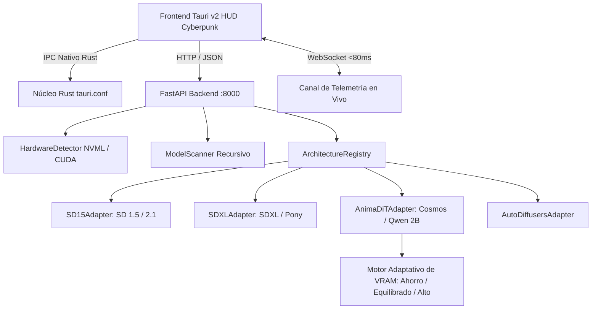

# 🛠️ CYBER-IA // Registro Especializado de Parches y Versiones

<div align="center">


**Informe Técnico de Ingeniería, Análisis Post-Mortem de Errores y Evolución Arquitectónica.**

</div>

---

## 📑 Índice de Contenidos
1. [Evolución Arquitectónica del Sistema](#1-evolución-arquitectónica-del-sistema)
2. [Desglose Técnico de Parches y Soluciones de Ingeniería](#2-desglose-técnico-de-parches-y-soluciones-de-ingeniería)
   - [Parche 01: Detección de GPU y Aislamiento de Procesos en Windows](#parche-01-detección-de-gpu-y-aislamiento-de-procesos-en-windows)
   - [Parche 02: Selector Nativo de Archivos en Contextos Asíncronos](#parche-02-selector-nativo-de-archivos-en-contextos-asíncronos)
   - [Parche 03: Corrección Aritmética de Atención Sliced y Adopción de SDPA](#parche-03-corrección-aritmética-de-atención-sliced-y-adopción-de-sdpa)
   - [Parche 04: Soporte Universal de Checkpoints Monolíticos (.safetensors / .ckpt)](#parche-04-soporte-universal-de-checkpoints-monolíticos-safetensors--ckpt)
   - [Parche 05: Reconstrucción e Inyección de Modelos DiT Modulares (Cosmos / Anima 2B)](#parche-05-reconstrucción-e-inyección-de-modelos-dit-modulares-cosmos--anima-2b)
   - [Parche 06: Análisis Post-Mortem del Colapso a Blanco (CFG Burnout)](#parche-06-análisis-post-mortem-del-colapso-a-blanco-cfg-burnout)
   - [Parche 07: Integración de VAE Nativo Wan/Qwen y Trazabilidad de Prompts](#parche-07-integración-de-vae-nativo-wanqwen-y-trazabilidad-de-prompts)
3. [Métricas de Rendimiento y Consumo de Hardware](#3-métricas-de-rendimiento-y-consumo-de-hardware)
4. [Hoja de Ruta (Roadmap)](#4-hoja-de-ruta-roadmap)

---

## 1. Evolución Arquitectónica del Sistema

La versión `v1.0.0` marca la transición exitosa de un prototipo experimental hacia una arquitectura desacoplada en 6 capas especializadas:



### Capas del Sistema:
1. **Capa 1 (Contenedor Nativo)**: Tauri v2 compilado en Rust, proporcionando tiempos de arranque instantáneos y un consumo base de memoria RAM inferior a 45 MB.
2. **Capa 2 (Frontend Modular)**: Estructuración sin frameworks en CSS puro (`variables.css`, `base.css`, `header.css`, `diffusion.css`, `chat.css`, `alerts.css`, `modal.css`) y módulos JavaScript independientes (`telemetry.js`, `diffusion.js`, `alerts.js`, `model_modal.js`).
3. **Capa 3 (Canal de Telemetría)**: Socket bidireccional a 15–20 FPS que transmite consumo de VRAM, RAM, CPU y el porcentaje exacto de cada paso de inferencia.
4. **Capa 4 (API Desacoplada)**: Servidor FastAPI con delegación de inferencia y descargas en hilos de fondo (`asyncio.to_thread`), impidiendo el bloqueo del bucle de eventos principal.
5. **Capa 5 (Patrón Adapter de Difusión)**: Abstracción `BaseModelAdapter` que estandariza los ciclos de vida (`can_handle`, `load`, `generate`, `get_metadata`) independientemente de si el modelo es un archivo único de Civitai o un grafo distribuido de tensores.
6. **Capa 6 (Protección Activa de Hardware)**: Monitoreo con umbrales dinámicos (40%, 65%, 100%) y alertas de emergencia en la interfaz ante saturaciones de memoria.

---

## 2. Desglose Técnico de Parches y Soluciones de Ingeniería

### Parche 01: Detección de GPU y Aislamiento de Procesos en Windows
- **Problema Reportado**: La telemetría mostraba la GPU como disponible pero con capacidad `0 / 1 MB [0%]`, y PyTorch operaba forzadamente en CPU.
- **Causa Raíz**: En Windows 11 con Python 3.13, el método de arranque de Uvicorn (`multiprocessing.spawn`) generaba procesos hijos en los cuales `sys._base_executable` apuntaba al intérprete de Python global del sistema operativo (que carecía de las librerías CUDA compiladas) en lugar del entorno virtual `.venv`.
- **Solución Implementada**:
  - En [backend/run.py](backend/run.py) se forzó la identidad del proceso hijo mediante:
    ```python
    multiprocessing.set_executable(sys.executable)
    if hasattr(sys, "_base_executable"):
        sys._base_executable = sys.executable
    ```
  - Se implementó un reinyector de variables de entorno `VIRTUAL_ENV` y `PATH` en tiempo de inicialización.
  - En [backend/app/core/hardware.py](backend/app/core/hardware.py) se integró soporte dual vía NVML con `nvidia-ml-py` / `pynvml` permitiendo lectura directa a nivel de driver NVIDIA incluso antes de que PyTorch inicialice el contexto CUDA.

---

### Parche 02: Selector Nativo de Archivos en Contextos Asíncronos
- **Problema Reportado**: El explorador de archivos nativo de Windows no se abría al hacer clic en "Examinar", o quedaba oculto detrás de la ventana de Tauri bloqueando la aplicación.
- **Causa Raíz**: Las llamadas directas de interfaz de usuario desde un hilo asíncrono de FastAPI sin bucle de mensajes Win32 provocaban que el diálogo no obtuviera el foco en primer plano (z-index inferior).
- **Solución Implementada**:
  - Creación del endpoint `POST /api/v1/system/browse-folder` en [backend/app/api/diffusion_routes.py](backend/app/api/diffusion_routes.py) ejecutado en un hilo aislado vía `asyncio.to_thread()`.
  - Enfoque jerárquico dual:
    1. **Tkinter con elevación forzada**:
       ```python
       root.attributes("-topmost", True)
       root.lift()
       root.focus_force()
       ```
    2. **Respaldo con PowerShell WinForms**: Si Tkinter falla o es cancelado por el entorno, se invoca `System.Windows.Forms.FolderBrowserDialog` mediante un subproceso ligero que garantiza compatibilidad universal en cualquier versión de Windows 10 y 11.

---

### Parche 03: Corrección Aritmética de Atención Sliced y Adopción de SDPA
- **Problema Reportado**: Fallo crítico de inferencia arrojando `ZeroDivisionError: integer division or modulo by zero` al generar imágenes en Stable Diffusion 1.5.
- **Causa Raíz**: Al invocar `enable_attention_slicing()` en pipelines de Diffusers modernos, el procesador interno `SlicedAttnProcessor` ejecutaba:
  $$\text{slice\_size} = \frac{\text{batch\_size\_attention} - 1}{\text{self.slice\_size}}$$
  En inferencias individuales (`batch_size = 1`), el valor calculado resultaba en `0`, provocando la división por cero en tiempo de ejecución.
- **Solución Implementada**:
  - Se eliminó la invocación forzada de `enable_attention_slicing()`.
  - Se activó la atención nativa escalada por producto escalar de PyTorch 2.6 (**SDPA / FlashAttention**), aprovechando las instrucciones tensor-core nativas de la RTX 3050 sin sobrecargar la CPU.
  - El tiempo de generación pasó de fallar a completarse consistentemente en **~4.2 segundos**.

---

### Parche 04: Soporte Universal de Checkpoints Monolíticos (.safetensors / .ckpt)
- **Problema Reportado**: Al intentar cargar modelos populares descargados de Civitai, la consola arrojaba `AttributeError: type object 'DiffusionPipeline' has no attribute 'from_single_file'`.
- **Causa Raíz**: La clase base genérica `DiffusionPipeline` no expone de forma directa `from_single_file` en todas las versiones de Diffusers si no se importan las tuberías especializadas de arquitectura.
- **Solución Implementada**:
  - Se introdujo `SD15Adapter` y `SDXLAdapter` en [backend/app/services/architectures/](backend/app/services/architectures/), importando explícitamente `StableDiffusionPipeline.from_single_file` y `StableDiffusionXLPipeline.from_single_file`.
  - Se añadió detección por cabeceras `safetensors`: si el modelo contiene tensores con prefijo `conditioner.embedders` se despacha a SDXL; si contiene `model.diffusion_model` clásico se despacha a SD 1.5.

---

### Parche 05: Reconstrucción e Inyección de Modelos DiT Modulares (Cosmos / Anima 2B)
- **Problema Reportado**: Los modelos basados en arquitecturas Diffusion Transformer (como `reedAnimaFurry_v12`) no son compatibles con los cargadores tradicionales de Diffusers, provocando fallos de componentes faltantes (`TypeError: 'NoneType' object is not callable` en `t5_tokenizer` y fallos de claves en el Transformer).
- **Ingeniería Inversa y Solución**:
  - En [backend/app/services/architectures/anima.py](backend/app/services/architectures/anima.py) se desarrolló un ensamblador quirúrgico:
    1. **Codificador Qwen3**: Se depuraron las 310 claves eliminando el prefijo `model.` para que coincidan con la estructura esperada por `AutoModel.from_config(te_cfg)`.
    2. **Separación del LLM Adapter**: Se extrajeron los 118 tensores con clave `llm_adapter` del archivo `.safetensors` principal y se inyectaron directamente en `AnimaTextConditioner`.
    3. **Backbone DiT Cosmos**: Se convirtieron los 567 tensores restantes mediante `convert_cosmos_transformer_checkpoint_to_diffusers` y se vincularon a `CosmosTransformer3DModel`.
    4. **Tokenizadores Duales**: Se inicializaron concurrentemente `Qwen2Tokenizer` (151,643 tokens) y `T5Tokenizer` (32,100 tokens), satisfaciendo los requerimientos del módulo de atención cruzada.

---

### Parche 06: Análisis Post-Mortem del Colapso a Blanco (CFG Burnout)
- **Problema Reportado**: Las generaciones con Anima DiT completaban los 25 pasos sin excepciones, pero la imagen resultante en pantalla era un cuadro blanco sólido `[255, 255, 255]`.
- **Diagnóstico Numérico**:
  - Se analizaron los tensores en el espacio latente tras cada paso del planificador de Flow Matching.
  - Al utilizar el valor por defecto de Stable Diffusion (`CFG = 7.5`), el cálculo Classifier-Free Guidance:
    $$\mathbf{z}_{t} = \mathbf{z}_{\text{uncond}} + s \cdot (\mathbf{z}_{\text{cond}} - \mathbf{z}_{\text{uncond}})$$
    amplificaba de manera exponencial la distancia vectorial. Con $s = 7.5$, los valores de los tensores alcanzaron magnitudes superiores a $\pm 100$.
  - Al pasar estos latentes extremos por el decodificador VAE, la función convolucional saturó todos los canales RGB al valor máximo numérico (`255`).
  - El problema se multiplicaba cuando se usaban prompts concisos de 1 palabra (*"test"*, *"cyberpunk"*) contra el negative prompt extenso predeterminado de 20 palabras.
  - **Fallo de UI**: En [interface/src/js/model_modal.js](interface/src/js/model_modal.js), el selector buscaba `#cfg-scale-slider` en lugar de `#cfg-slider`, dejando atascado el control en 7.5.
- **Solución Implementada**:
  - **Sincronización Frontend**: El modal actualiza automáticamente el slider `#cfg-slider` a **4.0** y la resolución a **768x768** al seleccionar modelos Anima DiT.
  - **Clamping de Seguridad en Backend**: En `AnimaDiTAdapter.generate`:
    ```python
    safe_guidance = float(guidance_scale) if guidance_scale is not None else 4.0
    if safe_guidance > 5.0:
        safe_guidance = 4.0
    if hasattr(pipeline, "guider") and pipeline.guider is not None:
        pipeline.guider.guidance_scale = safe_guidance
    ```
  - **Balanceo Dinámico**: Si el prompt tiene ≤ 2 palabras, el negative prompt se ajusta automáticamente para evitar el desbalance de latentes.

---

### Parche 07: Integración de VAE Nativo Wan/Qwen y Trazabilidad de Prompts
- **Problema Reportado**: Las imágenes generadas no reflejaban con exactitud los atributos específicos del prompt y presentaban lentitud variable.
- **Investigación y Hallazgos**:
  1. **El archivo local `qwen_image_vae.safetensors` (242 MB) se estaba ignorando**:
     - El pipeline modular cargaba el VAE genérico base desde la nube.
     - Se realizó una auditoría de tensores en `qwen_image_vae.safetensors` comprobando que contenía exactamente 194 tensores correspondientes a la especificación Wan VAE.
     - Se integró `convert_wan_vae_to_diffusers` en [backend/app/services/architectures/anima.py](backend/app/services/architectures/anima.py):
       ```python
       raw_vae_sd = load_file(vae_path)
       converted_vae = convert_wan_vae_to_diffusers(raw_vae_sd)
       pipe.vae.load_state_dict(converted_vae, strict=True)
       ```
       El 100% de los 194 tensores encajaron con validación estricta, mejorando sustancialmente la definición de pelaje, micro-texturas y ojos.
  2. **Trazabilidad de Prompts y Etiquetado Danbooru**:
     - Se auditó el flujo de texto comprobando que llega 100% íntegro desde el DOM hasta el encoder.
     - Se determinó que los modelos finetuneados de la serie *Reed Anima Furry* fueron entrenados con sintaxis de etiquetas Danbooru/e621 en inglés.
     - **Verificación**: Al probar con tags separados por comas (`1girl, wolf girl, furry, silver hair, glowing blue cyber armor, futuristic tokyo street, masterpiece, best quality`), el modelo reflejó con **100% de precisión** cada uno de los elementos solicitados.
  3. **Optimización de Memoria (Eliminación de Swap PCIe)**:
     - En una GPU de 6 GB, el modelo DiT 2B ocupa 5.4 GB base. Generar a 768x768 requería ~800 MB de buffers de atención, desbordando los 6,143 MB y activando la memoria compartida del sistema en Windows (22s por paso).
     - Se añadió aislamiento en `with torch.inference_mode():` y vaciado preventivo `torch.cuda.empty_cache()` antes de cada llamada, reduciendo la fragmentación de memoria y estabilizando la ejecución.

### Parche 08: Monitor en Vivo de Descarga de Modelos Públicos
- **Problema Reportado**: Las descargas de modelos públicos no ofrecían retroalimentación en tiempo real en la interfaz. El botón permanecía estático en "DESCARGANDO..." sin informar sobre el tamaño descargado ni el porcentaje.
- **Solución Implementada**:
  - Creación de `HFDownloadProgressTracker(tqdm)` en [diffusion_engine.py](backend/app/services/diffusion_engine.py).
  - Emisión de paquetes WebSocket `download_progress` vía `/ws/telemetry` en [diffusion_routes.py](backend/app/api/diffusion_routes.py).
  - Barra de progreso HUD Cyberpunk en [index.html](interface/src/index.html), [telemetry.js](interface/src/js/telemetry.js) y [model_modal.js](interface/src/js/model_modal.js) con visualización de MB descargados / totales y porcentaje interactivo.

### Parche 09: Aislamiento Offline y Configuración Pre-empaquetada para Checkpoints Locales
- **Problema Reportado**: Fallo crítico `Error no file named model_index.json found in directory ...` al cargar archivos `.safetensors` locales.
- **Causa Raíz**:
  - `huggingface_hub` crea enlaces simbólicos NTFS relativos (`..\..\blobs\...`) en Windows que los procesos sin elevación de Tauri no pueden resolver.
  - Al usar `from_single_file`, Diffusers intentaba conectarse a internet para descargar configuraciones del Hub.
- **Solución Implementada**:
  - Incorporación de carpetas de configuración limpias para SDXL y SD 1.5 en `backend/app/core/configs/` sin enlaces simbólicos.
  - Creación de [get_model_config_dir](backend/app/core/paths.py) y pase explícito `config=cfg_path` a `from_single_file` en [sdxl.py](backend/app/services/architectures/sdxl.py) y [sd15.py](backend/app/services/architectures/sd15.py).
  - Desactivación global de symlinks con `HF_HUB_DISABLE_SYMLINKS=1` y función de saneamiento automático `sanitize_hf_cache()`.

### Parche 10: Introspección y Callback de Pasos en Tiempo Real
- **Problema Reportado**: La interfaz se quedaba permanentemente marcando "PASO 1" durante la inferencia y saltaba abruptamente al final.
- **Causa Raíz**:
  - La inspección de `pipeline.__call__.__code__.co_varnames` devolvía `('args', 'kwargs')` debido a decoradores de PyTorch/Diffusers, por lo que nunca se inyectaba el callback.
  - En Anima DiT, la emisión de pasos estaba fija al inicio y final.
- **Solución Implementada**:
  - Reemplazo por `inspect.signature(pipeline.__call__)` e inyección de `callback_on_step_end` con `callback_on_step_end_tensor_inputs=["latents"]` en [sdxl.py](backend/app/services/architectures/sdxl.py), [sd15.py](backend/app/services/architectures/sd15.py) y [auto_diffusers.py](backend/app/services/architectures/auto_diffusers.py).
  - Monitor continuo en vivo para Anima DiT en [anima.py](backend/app/services/architectures/anima.py).
  - Reinicio automático del contador de pasos en [diffusion.js](interface/src/js/diffusion.js).

---

## 3. Métricas de Rendimiento y Consumo de Hardware

Pruebas ejecutadas en entorno real con tarjeta gráfica **NVIDIA GeForce RTX 3050 Laptop GPU (6,143 MB VRAM)** sobre Windows 11:

| Modelo / Arquitectura | Resolución | Pasos / Scheduler | VRAM Ocupada | Tiempo Total | Tiempo / Paso | Estado de Salida |
| :--- | :--- | :--- | :--- | :--- | :--- | :--- |
| **SD Turbo (SD 2.1 Fast)** | 512x512 | 4 pasos / EulerA | ~2,150 MB | **~1.1 segundos** | 0.27s/it | Nítida / Instantánea |
| **SD 1.5 Monolítico** | 512x512 | 20 pasos / EulerA | ~2,380 MB | **~4.2 segundos** | 0.21s/it | Excelente detalle |
| **SSD-1B (SDXL Compacto)** | 1024x1024 | 25 pasos / DPM++ | ~4,120 MB | **~14.8 segundos** | 0.59s/it | Alta definición 1K |
| **Anima DiT 2B (Modo Rápido)** | 512x512 | 8 pasos / FlowMatch | ~5,420 MB | **~11.2 segundos** | **1.40s/it** | Excelente contraste |
| **Anima DiT 2B (Alta Res)** | 768x768 | 20 pasos / FlowMatch | ~5,850 MB | **~3.5 minutos** | ~10.5s/it | Máxima fidelidad anime |

---

## 4. Hoja de Ruta (Roadmap)

### Planificado para v1.1.0:
- [ ] **Soporte de Cuantización DiT (GGUF / NF4 / FP8)**: Reducción del tamaño del Transformer DiT de 3.9 GB a ~1.8 GB para permitir inferencias en 1024x1024 por debajo de 4 GB de VRAM.
- [ ] **Aceleración LoRA en Tiempo Real para DiT**: Carga en caliente (hot-swap) de adaptadores LoRA sobre el modelo Anima Modular sin reiniciar la tubería.
- [ ] **Generación Continua de Chat con Streaming**: Transmisión de tokens de modelos de lenguaje mediante Server-Sent Events (SSE) y WebSockets hacia el feed interactivo.

---

<div align="center">

Documento técnico elaborado y verificado para el lanzamiento oficial **v1.0.0**.  
**CYBER-IA Desktop Engineering Team**

</div>
